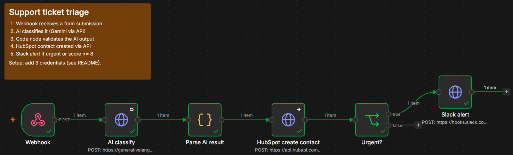
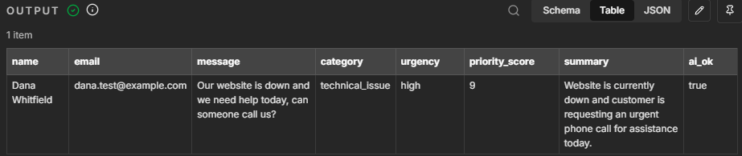
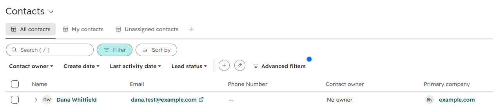
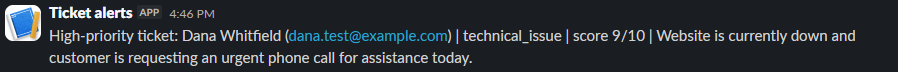
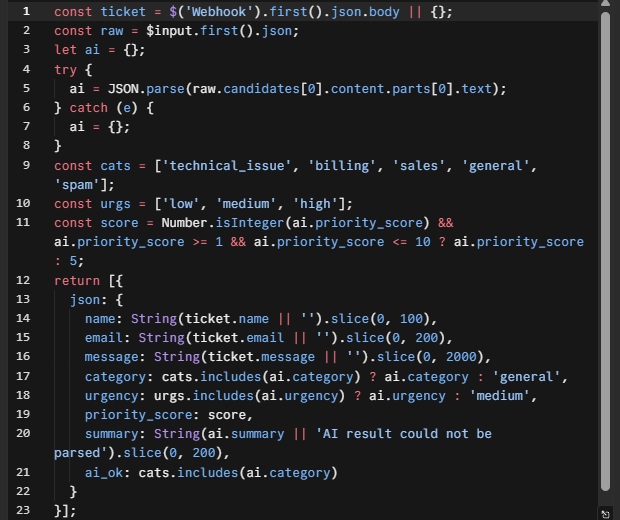

# AI Support Ticket Triage (n8n)

An n8n workflow that receives a support ticket from a contact form, uses AI to classify it, saves it to HubSpot, and alerts the team in Slack when it's urgent. It runs entirely on free tiers.



## The problem
Small teams lose customers because inbound messages sit in an inbox until someone has time to read, sort, and log them. Urgent requests get the same slow treatment as spam.

## What it does
1. **Webhook** receives the form submission (name, email, message).
2. **AI classify** sends the message to Google Gemini (Flash-Lite), which returns a category, urgency, priority score, and one-line summary as JSON.
3. **Parse AI result** (Code node) validates the AI output. Unknown values fall back to safe defaults, so a bad AI response can't break the run.
4. **HubSpot** creates the contact through the CRM API.
5. **Urgent?** checks for urgency = high or score ≥ 8.
6. **Slack** posts an alert to `#support` with the summary.

**AI output** (category, urgency, score, summary)



**HubSpot contact created**



**Slack alert**



## Results
- Replaces the manual routine of reading each ticket, judging its priority, and typing it into the CRM.
- Every ticket is sorted and saved within seconds of arriving, and urgent ones alert the team right away.

## APIs and integrations
| Service | How it connects | Auth |
|---|---|---|
| Webhook | n8n trigger, HTTP POST | n/a (test endpoint) |
| Google Gemini | REST API (`generateContent`) | API key in header |
| HubSpot CRM | REST API v3 (`/crm/v3/objects/contacts`) | Service key, Bearer token |
| Slack | Incoming webhook | Webhook URL |

## Reliability and security


- **Validated AI output.** The model's JSON is parsed and checked against allowed values before anything uses it.
- **Prompt-injection defense.** Ticket text is treated as data, never instructions, and is length-capped.
- **Retries.** The AI call retries up to 3 times.
- **Fail-safe CRM step.** If HubSpot rejects a contact (for example, a duplicate email), the alert still fires.
- **Least privilege.** The HubSpot key has only `contacts.read` and `contacts.write`, and the Slack app has only `incoming-webhook`.
- **Domain-locked credentials.** Each key can only be sent to its own service's domain.
- **No secrets in this repo.** Keys live in n8n's encrypted credential store, and the Slack URL is a placeholder.

## Run it yourself
1. Install n8n locally: `npm install n8n`, then `npx n8n`.
2. Import `workflow.json` (menu → Import from file).
3. Add credentials (Header Auth):
   - Gemini: name `x-goog-api-key`, value = key from Google AI Studio
   - HubSpot: name `Authorization`, value = `Bearer <service key>` with scopes `crm.objects.contacts.read` and `crm.objects.contacts.write`
4. Paste your Slack incoming-webhook URL into the "Slack alert" node.
5. Click **Execute workflow**, then send the sample ticket:
   ```
   curl -X POST http://localhost:5678/webhook-test/ticket-intake -H "Content-Type: application/json" -d @sample-ticket.json
   ```

## Next improvements
- Update existing HubSpot contacts instead of creating duplicates
- Save the AI's category, urgency, and score as HubSpot contact properties
- Log every run to a sheet for reporting
